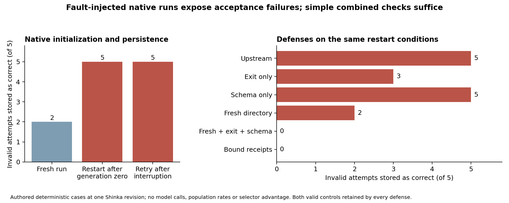

# AgentQA: Trustworthy Evaluation for Program Evolution

AgentQA studies how evaluation evidence can become detached from the program that produced it, and how simple checks prevent invalid results from entering an evolutionary search archive.

In controlled ShinkaEvolve restart experiments, stale or incomplete result files caused changed programs to be recorded as correct, archived, and tracked as best. A guard combining a fresh directory for each attempt, a successful process exit, and complete output validation rejected every tested invalid condition while preserving legitimate positive and negative evaluations.

## Results

| Study | Design | Finding |
| --- | --- | --- |
| Native lifecycle (N1) | 56 target cases across initialization, restart, interruption, and defenses | All five invalid conditions were accepted in both restart histories under upstream behavior; the combined guard rejected all five. |
| Standard helper (N2) | 24 cases comparing the pinned helper, a prior repair, and consumer checks | The prior helper repair protects attempts that enter it; consumer checks also cover failures before helper entry. |
| Repair-selection pilot (C1) | Nine controlled transfer cases per policy | Both generated repairs passed 9/9; every selector chose the same repair. No selector advantage was established. |

These are deliberately introduced faults in bounded experiments. The results do not estimate natural failure rates or improvements in long-run search quality. N2 tests the isolated helper from upstream PR #150, rather than the complete PR. The original hypothesis about selecting better generated repairs remains unresolved.



## Read and explore

- [Research report](report/final-report.md): methods, findings, attribution, and limitations.
- [Native study results](docs/native-followup-results.md): detailed N1/N2 outcomes.
- [Recorded interactive demonstration](report/demo-native/index.html): download or clone the repository, then open this file in a browser. It makes no network requests or model calls.
- [Reproduction guide](docs/reproduction.md): installation, saved-evidence verification, and optional reruns.
- [Research scope](docs/research-scope.md): completed studies and open questions.
- [Third-party attribution](third_party/NOTICE.md): upstream source and licenses.

## Quick start

Validated with Python 3.13.5 on macOS ARM64; the package requires Python 3.11 or later. The core has no third-party runtime dependencies. The development lock includes test and plotting tools.

```sh
git clone https://github.com/JamesTu-jtjt/agentqa.git
cd agentqa
python3 -m venv .venv
.venv/bin/python -m pip install -r requirements-dev.lock
.venv/bin/python -m pip install --no-build-isolation --no-deps -e .
.venv/bin/python -m pytest
.venv/bin/agentqa verify-evidence --root .
```

Saved-evidence verification requires no model access, Docker, or ShinkaEvolve installation. It checks 179 coding traces, 28 original publication receipts, 56 native databases/WAL records, seven additional bound receipts, and 24 helper cases. The historical clean installation passed 145 tests, with three optional Docker tests skipped.

For a small authored demonstration:

```sh
.venv/bin/agentqa demo --output runs/my-offline-demo
```

Use a new output directory for every experiment. Generated policies require the isolated Docker worker; the local subprocess evaluator is intended only for trusted authored code.

## Repository map

| Directory | Contents |
| --- | --- |
| `src/agentqa/` | Evidence contracts, replay, policy interfaces, and scheduler adapters |
| `tests/` | Unit, integration, and replay checks |
| `scripts/` | Experiment, analysis, visualization, and packaging entry points |
| `docs/` | Study protocols, results, and reproduction instructions |
| `evidence/` | Frozen plans, source snapshots, traces, results, and manifests |
| `report/` | Research report, measured figures, and recorded demonstrations |

Historical records retain original paths and identifiers because they participate in integrity checks. See the [disclosure audit](docs/public-disclosure-audit.md) for review scope and limitations.

## Research ownership

James Tu led research direction, system design, experimental exploration, and refinement. Codex assisted implementation, experiment execution, analysis, visualization, and writing. The pilot used three recorded model calls; N1 and N2 used no additional inference.
