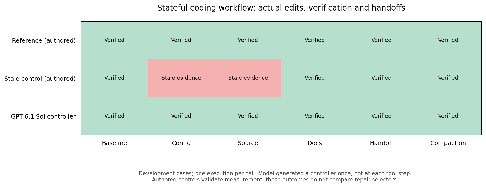
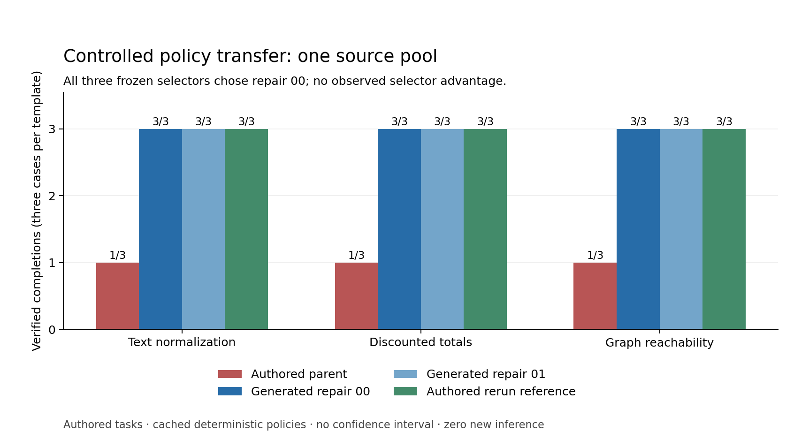
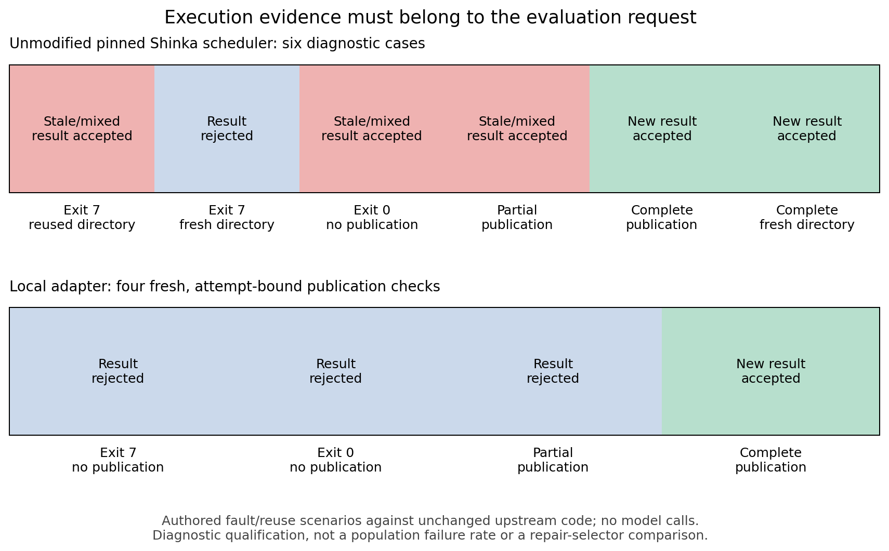
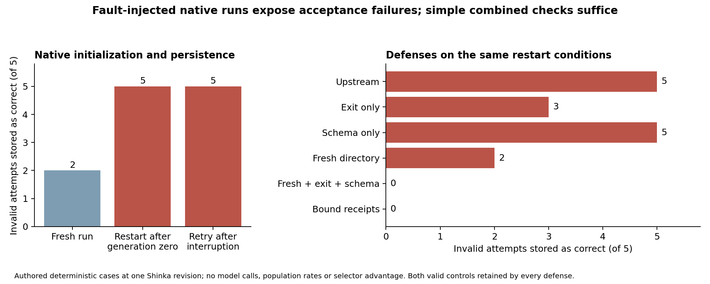

# Testing the Evidence Behind Agent Improvement

## A controlled repair pilot and native evaluation-integrity study

James Tu | Cornell University | Sakana AI research exercise | 2 November 2026

**AI assistance.** Codex implemented the prototype, ran the recorded experiments, analyzed outcomes and assisted report writing. James supplied research direction and resource constraints. No independent human review is claimed.

**Abstract.** Self-improving agents depend on evaluation results to decide which changes to retain. We study the trustworthiness of that evidence through a controlled repair pilot and a native ShinkaEvolve case study. The three-call GPT-6.1 Sol pilot produced two repairs that both passed nine controlled transfer cases; every selector chose the same repair, leaving the selection hypothesis unresolved. A prospectively frozen follow-up executed 56 native initialization/restart cells, including interruption before the first program insert. Under five authored invalid-publication conditions, restart and interruption retries each stored five target programs as correct and admitted them to the native archive and best-program state. Exit-only, schema-only and fresh-directory-only defenses left failures; fresh directories combined with exit and schema checks prevented all five, matching bound receipts and preserving positive and negative controls. A second frozen 24-cell study used the exact standard evaluation helper and a previously proposed upstream helper repair, crediting its protection inside helper entry while exposing the separate before-entry boundary. These deterministic fault-injection results establish bounded native consequences and repair scope, not natural failure rates, a new bug class or selector superiority.

## 1. Research question and scope

Can valid metamorphic families built around a known failure mechanism select repairs that transfer better than source-only retesting or generic variation, at matched evaluation budgets? The proposed contribution is selection value under valid transformations. Merely generating variants, adding provenance checks or fixing an authored example would not answer that question.

The initial failure class is **stale verification evidence**: passing tests for one source/test/configuration state are used to justify completion after a relevant change. The QA target is the connection between a claim and its execution evidence. A function can be correct while the evidence supporting completion is stale; conversely, a fresh weak test can pass while the function is wrong.

This pilot targets the reliability infrastructure around agent improvement. It aligns with empirical agent evolution and automated research [1-3], while holding the model-generated candidate pool fixed to isolate selection. The controlled audit evaluates cached completion policies after authored repairs. The native follow-up evaluates initialization, persistence and restart through the unchanged Shinka runner. Neither study tests models autonomously repairing new repositories, natural failure rates or a complete sampled evolutionary search.

**Delivered.** An executable QA prototype, a preserved null selector result, native restart/interruption counterexamples with database evidence, a six-defense comparison, an exact prior-helper comparison, and reproducible source, traces, figures and demonstrations. The strongest result concerns evaluation acceptance rather than generated repair selection.

<!-- page -->

# 2. Positioning and measurement contract

## Closest work and novelty boundary

The AI Scientist automates stages of the research lifecycle [1]. DGM maintains an archive of agents and empirically evaluates self-modifications [2]; ShinkaEvolve evolves executable programs using feedback [3]. AgentQA concerns the trustworthiness and generalization of acceptance evidence, rather than introducing a new archive sampler or mutation algorithm.

AgentAssay already studies agent metamorphic relations and regression testing [4]. SyncMind studies recovery from evolving collaborative repository states [5], and SWE-Touch injects validated conflicting edits during coding [6]. Thus neither agent metamorphic testing nor shared-workspace changes constitute a new contribution here.

HarnessFix connects failed traces to scoped harness repairs [7]. Self-Harness combines failure mining, candidate harness changes and regression validation [8]. A recent failure-feedback study distinguishes directed repair, transfer and net held-out change [9]. These precedents motivate a common-pool comparison with separate source, selection and audit roles. Agentic Scientist documentation also describes provenance consistency checks [10]. A freshness architecture alone is not a first-in-field claim.

The remaining research hypothesis is that **mechanism-directed, applicability-validated families improve which generated repair is selected**, beyond source-only or generic checks. The present pool does not supply evidence for that hypothesis. N1/N2 add an empirical study of native acceptance consequences and a real prior repair's scope; they do not retroactively validate the selector claim.

The narrower positioning also has precedents. Public Shinka PR #150 already discusses generation-zero resume detection and result crash consistency [11]. Statistical metamorphic testing of genetic algorithms predates this work [12]; recent agent-harness benchmarks separate execution reliability from task success [13,14]. We therefore claim a reproducible case study and bounded defense comparison, not the first use of metamorphic testing for evolution, harness QA, provenance or cache invalidation. The review is targeted, not an exhaustive novelty certification.

## Executable contract

A footprint hashes the declared source, visible tests, configuration and runtime identity. Fresh evidence requires an actual passing visible execution whose before/after footprint equals the final footprint. Functional correctness comes from evaluator-owned assertions. The primary endpoint is:

```
verified = declared completion AND functional correctness AND fresh evidence
```

Refusal is not successful completion. Failed tests and modified-during-test executions cannot become passing evidence because a model prints a success message. Exact restoration of tested content can reuse its receipt in the bounded deterministic world; unrelated documentation does not invalidate it. This contract does not cover undeclared external services, hidden dependencies, arbitrary environment nondeterminism or concurrent histories beyond observed states.

Host-owned, hash-chained records retain state, actual test status and completion. Replay checks integrity against frozen trace tips, not authenticity against an attacker replacing the entire store. Generated policy/controller code and generated task modules run only in Docker without host mounts, network or credentials, with bounded CPU/memory/processes/output/time. Trusted local subprocess fixtures execute authored code only. The boundary and oracle are separate from candidate-editable resources.

<!-- page -->

# 3. Design and prospective controls

## Feasibility before the audit

Three serial subscription inference calls used GPT-6.1 Sol with a 120-second bound per invocation. The first generated two completion-policy repairs from an authored always-complete parent and one authored clamp failure. Both policies inspect verification provenance. One unseeded policy and one stateful controller were generated in the remaining calls. No naturally observed semantic freshness failure was confirmed. Three original worker timeouts were preserved as infrastructure-inconclusive; an unchanged-program diagnostic later passed after startup and execution timing were separated.

The stateful workflow supports source edits, actual execution, configuration changes, compaction and handoff. Its generated controller passed six cases; an authored stale control failed two. The model generated a controller program once, not a new inference at every action. These feasibility outcomes do not establish realistic agent repair performance.



**Workflow figure.** Six cases per controller: the generated controller and authored reference pass all six; the authored stale control passes four. These are bounded deterministic workflows, not fresh model reasoning at every step.

## Matched selection on a common pool

The frozen pool contains the authored parent and both generated repairs. Every candidate received six selection slots per method and the same two unchanged-footprint regression controls. Eligibility requires no regression relative to the parent; ranking uses verified completion, then incremental API cost, then candidate ID. Parent retention is allowed. All three methods selected repair 00.

| Selector | Six selection slots per candidate |
| --- | --- |
| Source-only | Source identity repeated six times |
| Generic | Identity, consistent renaming and irrelevant observations, twice each |
| Failure-family | Identity, renaming, noise, compaction, handoff and cached evidence |

Repeated deterministic inputs equalize slots, not independent model samples. The 60 development trials and unfavorable lack of repair diversity remain preserved.

## Controlled transfer amendment C1

The exhausted allowance was not reset. C1 narrowed the next experiment to unchanged cached policies on three separately authored templates: text normalization, discounted integer-cent totals and blocked-node graph reachability. Each has a source repair after weak passing tests, a configuration change after verification, and an unrelated-documentation control: nine cases total. Templates differ from clamp, while the provenance interface and failure mechanism remain shared.

Before executing any new case, all development traces were replayed and selector decisions recomputed. The plan froze programs, decisions, templates, contract, analysis, dependencies, runtime/image, limits and retry rules. Commit **7ae8dd0** was pushed privately before outcomes existed. The three candidates and a nonselectable authored rerun reference produce 36 trials. Reservations precede execution; completed trials are replayed on resume, and interrupted unknown trials cannot silently resample. All declared slots are required; unreconciled infrastructure prevents comparison.

The paired unit is the **one source pool**. The three templates are not three generation pools. Cases receive equal weights; no interval is reported with this sample size. The same implementer authored both splits, so separation is procedural, not human blinding.

<!-- page -->

# 4. Controlled transfer results

| Policy | Verified / cases | Functional | Fresh | Refusals |
| --- | ---: | ---: | ---: | ---: |
| Authored parent | 3 / 9 | 9 / 9 | 3 / 9 | 0 |
| Generated repair 00 | 9 / 9 | 9 / 9 | 9 / 9 | 0 |
| Generated repair 01 | 9 / 9 | 9 / 9 | 9 / 9 | 0 |
| Authored rerun reference | 9 / 9 | 9 / 9 | 9 / 9 | 0 |



**Figure 1.** Each template contributes two freshness-sensitive cases and one unchanged control. The reference is authored and not selectable. Counts describe this fixed controlled suite, not population rates.

Both repairs reached the ceiling. Source-only, generic and failure-family selection had all chosen repair 00 before audit execution. Failure-family minus either baseline is therefore **0 percentage points**. Equal outcomes do not establish equivalence, and the identical selected ID prevents this pool from identifying selection value.

The parent's six failures separate correctness from evidence: the authored implementations passed functional checks, but completion reused old visible receipts. In the text case, repair 00 instead verified the changed implementation before completing. In a documentation control it completed immediately with a still-current receipt. Each generated repair requested six fresh verifications; the authored rerun reference requested nine. Including setup, those are 15 versus 18 visible executions, a local tool-count observation rather than a realistic efficiency estimate.

All 36 trials were retained, with no retries, exclusions or infrastructure-inconclusive slots. They used 57 completed Docker workers, 59.54 summed worker seconds and confirmed cleanup. Each trace replayed before normalization. No additional inference was used. The result supports narrow completion-policy transfer after authored repairs; it does not support a mechanism-guided selector advantage.

<!-- page -->

# 5. Native evaluation-integrity study

## Existing scheduler behavior, a separate endpoint

The upstream diagnostic uses unchanged ShinkaEvolve code at revision **8adc053a2ce4511ad2ac310e004c530a73fb974a**. Fixed authored evaluators submit actual local jobs. A prior job publishes score 1 and correctness true; a changed request then reuses or replaces the result directory. The endpoint is valid attribution to the current request, not coding-agent verified completion.

| Authored scenario | Observed scheduler result | Attribution |
| --- | --- | --- |
| Exit 7; reuse old directory | Prior success and score 1 | Stale |
| Exit 7; fresh directory | No prior success available | Rejected |
| Exit 0; no publication; reuse | Prior success and score 1 | Stale |
| Metrics only; reuse | New score 0.25 plus old correctness | Mixed |
| Complete publication; reuse | New success and score 0.25 | Current |
| Complete publication; fresh | New success and score 0.25 | Current |



**Publication figure.** The pinned source diagnostic and four current authored adapter checks use distinct result-attribution endpoints. Broader twenty-case qualification is reported separately below.

Result files are loaded independently and lack an attempt binding at this public scheduler boundary. A return-code-only guard would address exit 7 but miss zero-exit nonpublication and partial publication. The scenarios demonstrate mechanism-level counterexamples to a narrow guard; they are not model-generated repair comparisons.

Three of six deliberately selected scenarios violated the attribution contract. This is not a prevalence estimate, an observed model reasoning error, a security exploit, or evidence that published Sakana results are invalid. Normal exclusive proposal directories reduce exposure. The later N1 study below tests native initialization/restart reachability and database consequences; long-run sampled evolution remains unperformed. Source copies, hashes and license attribution are preserved.

## Authored attempt-bound adapter

The local adapter creates a fresh attempt directory and binds a host receipt to request identity, declared input hashes, runtime, exact launch-command hash, actual process status and complete publication artifacts. It rejects nonzero, absent, partial, malformed, changed-input and tampered evidence. A complete negative evaluation can remain valid evidence; validity and correctness are distinct.

Four real scheduler checks matched their contracts. A broader fixed qualification added 20 authored cases spanning positive/negative results, publication ordering, invalid score types/duplicate keys, input changes and absent output, across two layouts. All 20 contracts matched and all ten renamed pairs preserved verdicts. These are qualification cases from an authored producer, not independent source pools or an audit of model agents.

The adapter is a local proof of concept, not an upstream merged fix or a sandbox for arbitrary evaluators. Before/after hashing cannot prove the absence of transient changes that are restored, and undeclared inputs remain outside the guarantee. This diagnostic motivates stronger acceptance contracts but does not turn the null selector result into a positive one.

## Native reachability and simple defenses: N1

N1 froze 56 target cells, authored programs/evaluator, defenses and analysis in commit **1c6a88d** before execution. The exact public main revision was independently checked and matched the tested pin on 2 November 2026. Each native run used `ShinkaEvolveRunner.run()` with a supplied initial program, one generation and one island, with models, embeddings, novelty, meta evolution and W&B disabled. Actual evaluation, database insertion, archive maintenance, best tracking and termination ran; no upstream source was patched. A transparent submit observer captured process exits. Authored defenses interposed only at the scheduler run boundary.

Seven targets cover nonzero/no output, zero/no output, metrics only, correctness only, full publication followed by exit 7, complete positive and complete negative. The strict contract requires zero exit and complete finite/schema-valid output from the current attempt. In particular, full publication followed by nonzero exit is invalid under this declared contract; accepting durably committed output despite later failure would be a different contract.

The 21 reachability cells cross those targets with a fresh run, restart after completed generation zero, and retry after an actual process-group interruption before the initial database insert. For interruption, the primer publishes genuine output, emits a barrier marker and blocks; the controller terminates it and verifies an empty native program table before retry. No database rows are edited or deleted. A changed seed is then supplied. This is a controlled restart condition, not a naturally observed run or proof that all ordinary resumes are exposed.

All five invalid targets were stored with `correct=True`, archived and tracked as best in both restart histories. Fresh runs accepted two of the five: correctness-only output with default score zero, and full output followed by nonzero exit. The difference identifies retained-output dependence for the other three conditions while separating independent schema/status omissions. Normal exclusive proposal directories mitigate retained-output exposure; no sampled post-initialization evolution was run.



**Native figure.** Counts are qualification outcomes among five deliberately chosen invalid conditions, not estimated failure rates. Both legitimate controls were preserved by every defense. N1 includes 56 distinct target cells and 49 primers: 105 evaluator processes, seven deliberately interrupted, with zero new inference calls.

| Defense | Incorrectly accepted / 5 invalid attempts | Invalid target archived | Invalid target best | Positive / negative preserved |
| --- | ---: | ---: | ---: | --- |
| Upstream | 5/5 | 5 | 5 | 1/1; 1/1 |
| Exit only | 3/5 | 3 | 3 | 1/1; 1/1 |
| Schema only | 5/5 | 5 | 5 | 1/1; 1/1 |
| Fresh directory | 2/5 | 2 | 1 | 1/1; 1/1 |
| Fresh + exit + schema | 0/5 | 0 | 0 | 1/1; 1/1 |
| Bound receipts | 0/5 | 0 | 0 | 1/1; 1/1 |

The six-defense comparison shares the seven upstream/completed cells with reachability and adds 35 target cells with their own native primers. Exit-only checks miss zero-exit stale or mixed results; schema-only checks accept well-formed historical files; fresh directories leave independent incomplete-output and process-status cases. **Fresh directory plus exit plus schema matches bound receipts on every tested condition.** Receipts add replayable attribution here, without a demonstrated acceptance-accuracy benefit over the simple combined guard. Invalid score retention without positive acceptance is reported separately in the machine-readable analysis.

## Standard producer and prior-repair boundary: N2

To address the custom-publisher limitation, N2 froze 24 additional cells in commit **9799639**, using the exact standard `run_shinka_eval` helper from the main pin and from PR #150 head `7f6b67e20cd44821dd9d7df0d15d5905cefe43d8`. The PR is closed and unmerged. Its helper invalidates prior correctness markers at entry; that repair belongs to upstream contributors. We test only those isolated helper modules, not the complete PR, its resume guard or shutdown changes.

Each helper runs through the real local scheduler, with an actual successful primer, a changed authored program, and either the raw consumer or the simple combined guard. Authored exits 7 and 0 occur either inside the sequential experiment or before helper entry. Complete positive and negative evaluations are controls. Moving the same failed termination across helper entry preserves the requirement not to attribute a prior success to the changed attempt and probes the repair's applicability boundary.

| Producer and consumer | Invalid accepted inside helper / 2 | Invalid accepted before entry / 2 | Positive / negative preserved |
| --- | ---: | ---: | --- |
| Main helper; raw consumer | 2/2 | 2/2 | 1/1; 1/1 |
| Prior PR helper; raw consumer | 0/2 | 2/2 | 1/1; 1/1 |
| Main helper; combined guard | 0/2 | 0/2 | 1/1; 1/1 |
| Prior PR helper; combined guard | 0/2 | 0/2 | 1/1; 1/1 |

The prior helper repair works within its entry boundary. It cannot invalidate a marker before it executes; consumer-side checks protect that separate boundary in these cases. This is a precise scope result, not evidence that the complete PR is defective or that its authors promised broader protection. N2 used 48 evaluator processes and no inference. Neither N1 nor N2 is a generated-repair selection audit or an estimate of spontaneous failures.

<!-- page -->

# 6. Interpretation, resources and conclusion

## What the evidence supports

N1 connects result-attribution faults to actual native persistence, archive membership and best-program tracking. N2 confirms the mechanism through the standard producer and identifies the applicability boundary of an existing producer repair. These are concrete, reproducible QA findings at a self-improvement acceptance boundary. The minimal combined consumer guard matches receipts on the tested conditions; no accuracy advantage for receipts is established. The controlled policy audit remains a separate, inconclusive selector experiment.

**The original selection hypothesis remains inconclusive.** Explicit fingerprints make the completion decision easy, both repairs reach the ceiling, and every selector chooses the same candidate. Neither more deterministic repetitions nor relabeling authored controls as generated repairs would resolve this limitation. No source-conditioned native-agent pool with useful behavioral variation was obtained within the allowance.

## Limits and conditions for a larger study

The repair pilot has one authored source, one model backbone and generated programs making deterministic actions. N1 runs the native one-generation initialization lifecycle, including interruption and restart; it does not sample mutations or measure long-run search quality. N2 isolates two producer helpers and does not test the complete prior PR. All new process faults are authored. Natural failure prevalence, live model reasoning per tool step, multiple real repositories and independent human review remain absent. Strong functional oracles here do not solve test adequacy in realistic projects. C1 is opened and cannot be reused for tuning while retaining a held-out claim.

A larger study would need a separately bounded discovery/generation allowance, realistic qualified source failures, unchanged common repair pools, all three matched selectors and a new audit sealed before selection. Generation failures and unsuccessful candidates must remain; no positive result is required. This is future work, not silently completed work or additional spending authorization.

## Resource and reproducibility accounting

| Stage | Recorded resource |
| --- | --- |
| All experimental inference | 3 Codex subscription calls; no separately billed API calls |
| Reported tokens | 27,232 input; 2,458 output; reasoning field recorded separately |
| Subscription dollar cost | Unavailable, not zero |
| Stateful workflow | 18 trials; 152 workers; 109.13 worker seconds |
| C1 controlled audit | 36 trials; 57 workers; 59.54 worker seconds |
| Retained replay coverage | 179 coding traces; 28 publication receipts |

N1 added 105 evaluator processes and N2 added 48, with zero new model calls. All declared target cells completed; seven N1 primers were deliberately interrupted. Offline replay reads 56 actual native databases plus WAL files and seven additional bound receipts. The first replay updated volatile SQLite shared-memory read marks; the original manifest and explicit replay amendment are preserved. Durable database/WAL hashes remained unchanged, and replay now uses temporary copies. No experimental cell was rerun to repair verification.

Worker sums exclude orchestration/fixture/analysis time. Original infrastructure-inconclusive attempts remain. Offline tests and clean noneditable wheel reproduction validate implementation; they are not independent scientific replications. Exact package versions, image digest, upstream revision, input/output/code hashes, scripts and recorded evidence accompany the private repository.

**Conclusion.** Evaluation evidence can cross an attempt boundary and alter a native self-improvement archive under controlled faults. The strongest practical result is that fresh attempts, actual exit checks and complete schema validation jointly handle all tested native conditions while preserving valid negative evidence. A published producer repair works within its tested entry boundary, reinforcing the value of testing where a repair applies. This is a bounded empirical QA contribution, not a new cache-invalidation principle, a first harness-testing method, or evidence of improved model-repair selection.

<!-- page -->

# References

Primary sources checked 2 November 2026. Versioned papers are cited where available. This is a targeted review; no exhaustive novelty certification is claimed.

[1] Lu et al. **Towards end-to-end automation of AI research.** Nature 651, 914-919 (2026). [Version of record](https://www.nature.com/articles/s41586-026-10265-5); [open full text](https://pmc.ncbi.nlm.nih.gov/articles/PMC13017497/).

[2] Zhang et al. **Darwin Godel Machine: Open-Ended Evolution of Self-Improving Agents.** arXiv:2505.22954v3. [Paper](https://arxiv.org/html/2505.22954v3).

[3] Lange, Imajuku and Cetin. **ShinkaEvolve: Towards Open-Ended And Sample-Efficient Program Evolution.** arXiv:2509.19349v1. [Paper](https://arxiv.org/html/2509.19349v1).

[4] **AgentAssay: Token-Efficient Regression Testing for Non-Deterministic AI Agent Workflows.** Technical report, arXiv:2603.02601v1, section 6.1. [Paper](https://arxiv.org/html/2603.02601v1).

[5] Guo et al. **SyncMind: Measuring Agent Out-of-Sync Recovery in Collaborative Software Engineering.** arXiv:2502.06994v2. [Paper](https://arxiv.org/html/2502.06994v2).

[6] Tan et al. **Benchmarking Coding Agents When Users Touch the Code.** arXiv:2608.02499v1. [Paper](https://arxiv.org/html/2608.02499v1).

[7] Chen et al. **From Failed Trajectories to Reliable LLM Agents: Diagnosing and Repairing Harness Flaws.** arXiv:2606.06324v2. [Paper](https://arxiv.org/html/2606.06324v2).

[8] Zhang et al. **Self-Harness: Harnesses That Improve Themselves.** arXiv:2606.09498v3. [Paper](https://arxiv.org/html/2606.09498v3).

[9] He. **Does Failure Feedback Direct Agent Self-Modification?** arXiv:2610.14662v1. [Paper](https://arxiv.org/html/2610.14662v1).

[10] Sakana AI. **AI-Scientist-v3 usage guide.** Source-evidence consistency and review handling; accessed 2 November 2026. [Official documentation](https://github.com/SakanaAI/AI-Scientist-v3/blob/main/docs/usage.md).

[11] ShinkaEvolve contributors. **Public PR #150: correctness and concurrency findings from deep review.** Closed, unmerged; helper head `7f6b67e20cd44821dd9d7df0d15d5905cefe43d8`. [Prior fix](https://github.com/SakanaAI/ShinkaEvolve/pull/150).

[12] Rounds and Kanewala. **Systematic Testing of Genetic Algorithms: A Metamorphic Testing based Approach.** arXiv:1808.01033v1. [Paper](https://arxiv.org/abs/1808.01033v1).

[13] Cao et al. **Trial by Trace: Benchmarking AI Agent Harnesses for Reliability and Failure Attribution.** arXiv:2610.32285v1. [Paper](https://arxiv.org/abs/2610.32285v1).

[14] Zhang et al. **When Agents Fail: Model or Harness--Who's to Blame?** arXiv:2610.32483v1. [Paper](https://arxiv.org/abs/2610.32483v1).

## Implementation source and attribution

The grounded diagnostic preserves unmodified relevant files from the official [ShinkaEvolve repository](https://github.com/SakanaAI/ShinkaEvolve) at the exact revision in section 5. The Apache license and file-level hashes are included under `evidence/upstream-source-006/upstream-source/` and `third_party/`. No upstream code was changed or submitted.

## AI assistance disclosure

James Tu supplied research direction and resource constraints. Codex implemented the prototype, orchestrated experiments, analyzed records and assisted report writing. The three experimental inference calls are separately logged; ordinary coding/report work is not misreported as additional experimental subjects. No independent human review, external submission or peer review is claimed.

<!-- page -->

# Appendix: audit and artifact map

## Frozen identities

C1 plan hash:

```
fddddb72f75b21e6b98f89506ea7634c2ec348f76ee4e5e4a2ccd2d5c035ebb3
```

Candidate-pool hash:

```
3984309eae4921b0679c4807a2ed56b584193b498e11defaf228baa4a5d7c34e
```

Freeze commit `7ae8dd0` contains the plan and snapshots but no audit trials. It was pushed before execution. Candidate generation predates template authorship. All methods selected repair 00 before opening outcomes. Current manifests preserve historical snapshots rather than pretending subsequent code changes were part of an earlier freeze.

## Generated repair 00, unchanged

```
def choose_action(observation):
    evidence = observation.get('evidence') or {}
    current = observation.get('current_fingerprint')
    if (current and evidence.get('fingerprint') == current
            and evidence.get('status') == 'passed'):
        return 'complete'
    return 'verify'
```

## Reproduction entry points

```
agentqa verify-evidence --root .
python -m pytest
python scripts/build_repro_bundle.py --output dist/my-reproduction.zip
```

These commands verify saved evidence and package files; the tests use authored fixtures. No new inference is required. Docker is needed for new generated-program execution, not saved replay. The lifetime experimental allowance is exhausted; cloning or deleting a ledger does not reset it. Exact CLI/environment setup is in `docs/reproduction.md`.

| Artifact | Repository path |
| --- | --- |
| Native plan, 56 cells and databases | `evidence/native-initialization-013/` |
| Standard helper / prior-repair boundary | `evidence/standard-wrapper-014/` |
| Controlled plan, snapshots, full grid | `evidence/controlled-transfer-012/` |
| Development selection and frozen pool | `evidence/development-comparison-001/` |
| Source diagnostic and adapter checks | `evidence/upstream-source-006/`, `evidence/bound-shinka-008/` |
| Broader publication qualification | `evidence/publication-qualification-011/` |
| Measured figures, CSV and tables | `report/figures/` |
| Final recorded demonstration | `report/demo-native/index.html` |
| Full procedure and accounting | `docs/reproduction.md`, `docs/budget.md` |

Private repository: [JamesTu-jtjt/agentqa](https://github.com/JamesTu-jtjt/agentqa). The original native-agent main study remains unperformed.
