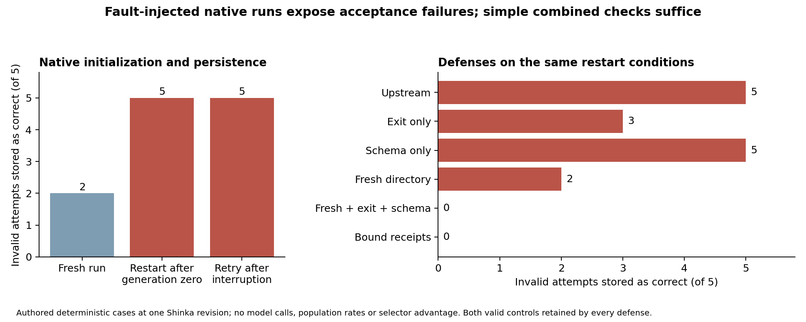

# When Evaluation Evidence Outlives Its Attempt

## Native acceptance failures and minimal defenses in ShinkaEvolve

James Tu | Cornell University | Sakana AI research exercise | 2 November 2026

**Research ownership and AI assistance.** I led the overall research direction, system design, experimental exploration and refinement. Codex assisted implementation, experiment execution and orchestration, analysis, and writing. I take responsibility for the study design, interpretation and final claims. The three logged experimental model calls are distinct from this development assistance. The study has not received independent human review.

**Abstract.** An evolutionary system can retain a program for the wrong reason when evaluation files from an earlier attempt survive into a later one. We investigate when that evidence crosses an attempt boundary in native ShinkaEvolve initialization, persistence and restart, and which checks prevent it. A prospectively frozen 56-cell study found that five deliberately invalid publication conditions were each stored as correct, archived and tracked as best after both completed-run restart and interrupted initialization. Fresh runs accepted two of the five, separating retained-output dependence from independent status and schema omissions. Fresh directories, exit checks and schema checks together rejected all five while preserving valid positive and negative evaluations; bound receipts matched that result. A separate frozen 24-cell study used the standard evaluation helper and an existing proposed helper repair. The repair protected failures after helper entry, while failures before entry required protection elsewhere. The contribution is a reproducible native case study of acceptance boundaries and repair scope. The injected cases do not estimate natural failure prevalence or long-run search degradation.

# 1. Question, mechanism and contribution

**Research question.** Under which initialization and restart conditions can an invalid evaluation change a native evolutionary archive, and what is the smallest tested defense that preserves legitimate results?

The mechanism is concrete. A successful first request writes metrics and correctness files. A changed request reuses that result location but exits, publishes nothing, or publishes only part of the required result. A consumer that loads files independently can combine old and new evidence and associate it with the changed program. Acceptance then affects persistent search state, rather than merely displaying an incorrect status message.

The contribution has three parts: a native reachability experiment with actual database/archive/best-program consequences; a comparison of single checks, combined checks and bound receipts; and a test of the applicability boundary of a prior producer-side repair. The practical finding is that the simple combined consumer guard matches receipts on the tested conditions. This gives a concrete repair target without evidence that the more elaborate provenance mechanism improves acceptance accuracy.

ShinkaEvolve [3], DGM [2] and the AI Scientist [1] motivate the setting: empirical acceptance decisions determine what a self-improving system retains. Existing Shinka PR #150 already addresses evaluation crash consistency and generation-zero resume detection [11]. Metamorphic testing of genetic algorithms also predates this study [12]. The added evidence is the demonstrated native consequence and bounded repair comparison. Related work on agent metamorphic testing, repository-state changes, harness repair and failure attribution [4–10,13,14] informs the earlier selector pilot; that pilot remains inconclusive.

# 2. Experimental design

## Native lifecycle study: N1

We froze programs, fault conditions, defenses and analysis in commit `1c6a88d` before execution. The tested ShinkaEvolve revision is `8adc053a2ce4511ad2ac310e004c530a73fb974a`. Each run invokes the unchanged `ShinkaEvolveRunner.run()` with a supplied initial program, one generation and one island. Evaluation, database insertion, archive maintenance, best tracking and termination execute normally. Model generation, embeddings, novelty, meta evolution and W&B are disabled. Defenses interpose at the scheduler run boundary; upstream source is unmodified.

Seven targets cover five invalid attempts and two controls. The invalid conditions are nonzero exit/no output, zero exit/no output, metrics only, correctness only, and complete publication followed by exit 7. Controls publish complete positive and complete negative results. Our acceptance contract requires zero exit plus complete, finite, schema-valid output attributable to the current attempt. A system accepting durably committed output despite subsequent process failure would need a different declared contract.

The reachability grid crosses seven targets with three histories: a fresh run, restart after completed generation zero, and retry after interruption before initial database insertion. For interruption, a primer publishes genuine successful output, emits a barrier and blocks. The controller terminates its process group and verifies an empty native program table before retrying with a changed seed program. Database rows are never edited or deleted.

The defense comparison uses the completed-restart history and the same seven targets. Six methods are tested: upstream behavior, exit-only, schema-only, fresh-directory-only, fresh directory plus exit plus schema, and bound receipts. It shares seven upstream cells with reachability, giving **56 distinct target cells and 49 primers: 105 evaluator processes**, including seven deliberate interruptions. All declared cells completed; no inference calls were used.

## Standard producer and existing repair: N2

A second plan was frozen in commit `9799639`. It tests the exact standard `run_shinka_eval` helper from the main pin and the isolated helper from PR #150 head `7f6b67e20cd44821dd9d7df0d15d5905cefe43d8`. That prior helper repair invalidates old correctness markers at entry. We credit that behavior to its upstream authors and test the helper only; the complete PR, its resume guard and shutdown changes are outside this comparison.

Each helper runs through the real local scheduler after a successful primer. Authored exits 7 and 0 occur either inside the sequential experiment or before helper entry. Complete positive and negative evaluations are controls. Two producer versions, two consumer policies and six conditions produce **24 cells and 48 evaluator processes**. Moving termination across helper entry tests where the prior repair can act while preserving the obligation to avoid attributing old success to the changed attempt.

# 3. Native consequences and minimal defenses

All five invalid targets were stored with `correct=True`, entered the archive and became best in both restart histories. Fresh runs accepted two: correctness-only output with default score zero, and full output followed by nonzero exit. The fresh/restart difference identifies retained-output dependence for three conditions; the remaining two expose independent completeness and process-status checks.



**Figure 1.** Outcomes among five deliberately invalid conditions. Counts are qualification results for the chosen faults. Every defense preserves both legitimate controls.

| Defense | Invalid accepted / 5 | Invalid archived | Invalid best | Positive / negative preserved |
| --- | ---: | ---: | ---: | --- |
| Upstream | 5 | 5 | 5 | 1/1; 1/1 |
| Exit only | 3 | 3 | 3 | 1/1; 1/1 |
| Schema only | 5 | 5 | 5 | 1/1; 1/1 |
| Fresh directory | 2 | 2 | 1 | 1/1; 1/1 |
| Fresh + exit + schema | 0 | 0 | 0 | 1/1; 1/1 |
| Bound receipts | 0 | 0 | 0 | 1/1; 1/1 |

The individual checks leave different gaps. Exit checks miss zero-exit nonpublication. Schema checks accept well-formed historical files. Fresh directories remove old artifacts but leave status and incomplete-output failures. Their combination handles every tested condition. Bound receipts additionally record request identity, declared input hashes, runtime, launch command, actual process status and publication hashes, but demonstrate no acceptance-accuracy advantage over the combined guard here.

The best-program endpoint differs from archive membership: under fresh-directory-only defense, two invalid programs are archived but only one becomes best. We retain both endpoints rather than treating all persistence outcomes as equivalent. Complete negative evaluations remain valid evidence and are preserved throughout.

# 4. Where the prior helper repair applies

| Producer and consumer | Invalid accepted inside helper / 2 | Invalid accepted before entry / 2 | Positive / negative preserved |
| --- | ---: | ---: | --- |
| Main helper; raw consumer | 2 | 2 | 1/1; 1/1 |
| Prior PR helper; raw consumer | 0 | 2 | 1/1; 1/1 |
| Main helper; combined guard | 0 | 0 | 1/1; 1/1 |
| Prior PR helper; combined guard | 0 | 0 | 1/1; 1/1 |

The prior repair succeeds within its entry boundary. It cannot invalidate old markers before its code executes. Consumer-side checks cover that separate boundary in these cases. This distinction narrows the repair requirement: a producer can strengthen its own publication protocol, while the consumer still needs to verify the attempt it accepts. The experiment evaluates applicability, not the correctness of the complete prior PR.

# 5. Research path and the inconclusive selector pilot

The original project asked whether mechanism-directed metamorphic families select repairs that transfer better than source-only or generic checks. Its feasibility gate was candidate diversity: selectors need repairs with different behavior on relevant scenarios before their selection value can be distinguished.

Three serial GPT-6.1 Sol invocations produced two source-conditioned completion policies, an unseeded policy and a stateful controller. The two repairs both compare passing evidence with an explicit current fingerprint. All three selectors chose repair 00 on the fixed common pool. A separately frozen controlled transfer amendment, C1, then tested the parent, both repairs and a nonselectable authored reference on nine cases across text normalization, integer-cent totals and graph reachability.

| Policy | Functional / 9 | Fresh / 9 | Verified completion / 9 |
| --- | ---: | ---: | ---: |
| Authored always-complete parent | 9 | 3 | 3 |
| Generated repair 00 | 9 | 9 | 9 |
| Generated repair 01 | 9 | 9 | 9 |
| Authored rerun reference | 9 | 9 | 9 |

Every selector had already selected the same ID, so C1 cannot identify selection value. Different application templates still expose the same fingerprint interface; their success supplies narrow completion-policy transfer evidence. It supplies little information about realistic coding-agent repair generalization. All 36 trials were retained without retries or exclusions. Three earlier worker timeouts remain infrastructure-inconclusive in their original records.

This limitation changed the research focus. Rather than expand a nondiscriminating selector comparison, the native studies ask whether evidence failures reach consequential search state and whether simple defenses suffice. The frozen native results support that narrower question. A future selector study should first establish a qualified, behaviorally diverse pool, then seal a new audit; C1 is already exposed.

# 6. Interpretation and limits

The evidence establishes that controlled evaluation faults can cross an attempt boundary and alter actual native archive and best-program state. It also identifies a sufficient combination of simple checks for the tested conditions and demonstrates the scope of an existing helper repair. Both native experiments preserve complete negative evidence, avoiding a defense that merely rejects everything.

The main external-validity gap is exposure during ordinary use. Normal exclusive proposal directories reduce retained-output exposure. N1 exercises one-generation initialization and restart under authored faults; N2 isolates two helpers. Neither samples long-run mutations, estimates spontaneous fault rates, nor measures resulting degradation in search quality. Five invalid conditions and deterministic repeats cannot supply population confidence intervals. A useful next experiment would trace ordinary multi-generation runs to measure how often request/result identities diverge and whether such events change retained candidates, under a separately authorized budget.

Before/after hashes cover declared state and can miss transient changes restored between observations. Receipts are replayable integrity records, not protection against replacement of the entire trusted store. Functional correctness still depends on an adequate oracle. These boundaries constrain both the provenance prototype and any broader claims about reliable autonomous research.

# 7. Reproduction and contribution

The original project implementation comprises the executable evidence contract, isolated generated-policy workers, transformation/selection prototype, scheduler adapters, native lifecycle experiments, replay validators and measured report artifacts. Upstream source copies, licenses and file hashes are preserved. I led research direction, system design, experimental exploration and refinement; Codex assisted implementation, orchestration, analysis and writing.

The full experimental inference allowance remains **three calls**, reporting 27,232 input and 2,458 output tokens, with reasoning recorded separately. Subscription dollar cost is unavailable. N1 and N2 use no additional inference. Saved replay covers 179 coding traces, 28 earlier publication receipts, 56 native databases with WAL records, and seven additional bound receipts. Replay uses temporary copies; the documented amendment preserves the original manifest after an initial replay touched volatile SQLite shared-memory marks while durable database/WAL hashes remained unchanged.

Reproduction entry points:

```
agentqa verify-evidence --root .
python -m pytest
python scripts/build_repro_bundle.py --output dist/my-reproduction.zip
```

These verify saved evidence and package the study. Exact installation, dependency/image identities and procedures are in `docs/reproduction.md`; new generated-program execution requires Docker. The private source repository is [JamesTu-jtjt/agentqa](https://github.com/JamesTu-jtjt/agentqa).

| Evidence | Path |
| --- | --- |
| Frozen native plan, cells and databases | `evidence/native-initialization-013/` |
| Standard helper and prior-repair boundary | `evidence/standard-wrapper-014/` |
| Frozen controlled transfer study | `evidence/controlled-transfer-012/` |
| Measured figure and source tables | `report/figures/native-initialization-013/` |
| Recorded demonstration | `report/demo-native/index.html` |
| Earlier full reports | Archived tabs in this document |

**Conclusion.** Native acceptance checks determine which evidence becomes evolutionary state. In the tested restart and interruption conditions, retained artifacts can admit invalid evaluations to that state. Fresh attempt directories plus process-exit and complete-schema validation handle every tested fault, while the prior producer repair protects its own entry boundary. This is a bounded, reproducible systems finding that motivates measuring real exposure before claiming an effect on evolutionary search.

# References

Primary sources checked 2 November 2026. Versioned papers are cited where available. This is a targeted review; no exhaustive novelty certification is claimed.

[1] Lu et al. **Towards end-to-end automation of AI research.** Nature 651, 914-919 (2026). [Version of record](https://www.nature.com/articles/s41586-026-10265-5); [open full text](https://pmc.ncbi.nlm.nih.gov/articles/PMC13017497/).

[2] Zhang et al. **Darwin Godel Machine: Open-Ended Evolution of Self-Improving Agents.** arXiv:2505.22954v3. [Paper](https://arxiv.org/html/2505.22954v3).

[3] Lange, Imajuku and Cetin. **ShinkaEvolve: Towards Open-Ended And Sample-Efficient Program Evolution.** arXiv:2509.19349v1. [Paper](https://arxiv.org/html/2509.19349v1).

[4] **AgentAssay: Token-Efficient Regression Testing for Non-Deterministic AI Agent Workflows.** Technical report, arXiv:2603.02601v1, section 6.1. [Paper](https://arxiv.org/html/2603.02601v1).

[5] Guo et al. **SyncMind: Measuring Agent Out-of-Sync Recovery in Collaborative Software Engineering.** arXiv:2502.06994v2. [Paper](https://arxiv.org/html/2502.06994v2).

[6] Tan et al. **Benchmarking Coding Agents When Users Touch the Code.** arXiv:2608.02499v1. [Paper](https://arxiv.org/html/2608.02499v1).

[7] Chen et al. **From Failed Trajectories to Reliable LLM Agents: Diagnosing and Repairing Harness Flaws.** arXiv:2606.06324v2. [Paper](https://arxiv.org/html/2606.06324v2).

[8] Zhang et al. **Self-Harness: Harnesses That Improve Themselves.** arXiv:2606.09498v3. [Paper](https://arxiv.org/html/2606.09498v3).

[9] He. **Does Failure Feedback Direct Agent Self-Modification?** arXiv:2610.14662v1. [Paper](https://arxiv.org/html/2610.14662v1).

[10] Sakana AI. **AI-Scientist-v3 usage guide.** Source-evidence consistency and review handling; accessed 2 November 2026. [Official documentation](https://github.com/SakanaAI/AI-Scientist-v3/blob/main/docs/usage.md).

[11] ShinkaEvolve contributors. **Public PR #150: correctness and concurrency findings from deep review.** Closed, unmerged; helper head `7f6b67e20cd44821dd9d7df0d15d5905cefe43d8`. [Prior fix](https://github.com/SakanaAI/ShinkaEvolve/pull/150).

[12] Rounds and Kanewala. **Systematic Testing of Genetic Algorithms: A Metamorphic Testing based Approach.** arXiv:1808.01033v1. [Paper](https://arxiv.org/abs/1808.01033v1).

[13] Cao et al. **Trial by Trace: Benchmarking AI Agent Harnesses for Reliability and Failure Attribution.** arXiv:2610.32285v1. [Paper](https://arxiv.org/abs/2610.32285v1).

[14] Zhang et al. **When Agents Fail: Model or Harness--Who's to Blame?** arXiv:2610.32483v1. [Paper](https://arxiv.org/abs/2610.32483v1).

#