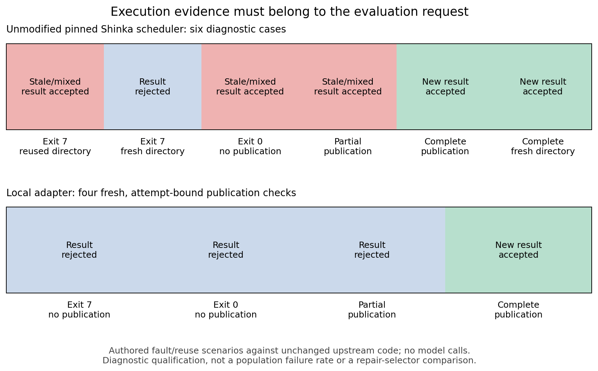

# Beyond the Repaired Example: working evidence report

**Development draft, 2 November 2026.** This records completed work and its limits. It is not the final submission, a completed independent audit, or evidence that the proposed selector improves agent repair.

## Question

Can valid metamorphic test families organized around a failure mechanism select coding-agent repairs that transfer better than source-only retesting or generic variation? The initial mechanism is stale verification evidence: a completion or fitness claim is attributed to a repository/evaluation state for which no valid passing execution exists.

The contribution would need both valid family construction and a matched selector comparison on common candidate pools. Agent metamorphic testing, workflow-state recovery, scoped harness repair, regression gates and provenance checks already have close precedents. The [methods notes](../docs/reading-notes.md) record these overlaps. We make no first-in-field claim.

## Implemented measurement

The prototype records host-owned execution events, content fingerprints and actual process outcomes. It grades functional correctness separately from evidence freshness, preserves failed attempts, and replays saved traces against frozen hashes. Generated policy/controller code and generated task modules run in resource-bounded Docker workers without host mounts, credentials or network. The first local fixture backend executes only authored code.

Development transformations include renaming, irrelevant observations, compaction/handoff and different evidence carriers. A stateful coding workflow requires a generated controller to write its task implementation, verify it, and handle relevant and irrelevant workspace changes. The model generates a controller program once; it is not a live model making a new inference at every tool step. This restriction substantially limits external validity.

ShinkaEvolve is pinned to `8adc053a2ce4511ad2ac310e004c530a73fb974a`. Its actual scheduler has evaluated the isolated policy bridge. The complete evolutionary search has not run. Candidate ancestry, attempts and frozen pools are preserved; the matched development runner resumes completed trials without resampling them.

## Completed pilot evidence

| Evidence | Observation | Supported interpretation |
| --- | --- | --- |
| [Source-conditioned policy generation](../evidence/codex-pilot-001/summary.json) | Two generated repairs, each 7/7 development cases | Model-to-isolated-evaluator integration works on this task. |
| [60-trial matched development comparison](../evidence/development-comparison-001/summary.json) | Every selector chose the same repair | No demonstrated selector advantage; pool was not discriminating. |
| [Unseeded policy](../evidence/unseeded-policy-002/summary.json) and [diagnostic](../evidence/unseeded-worker-recheck-003/summary.json) | Original four verified plus three infrastructure-inconclusive attempts; unchanged program later 7/7 | Preserve original failures; no confirmed semantic agent bug. |
| [Stateful controller](../evidence/stateful-controller-005/summary.json) | Generated controller 6/6; authored reference 6/6; authored stale control 4/6 | Actual edits/handoffs work; the stale control qualifies measurement, not natural failure discovery. |

The generated stateful controller reran after configuration changes. After an added source comment, it restored the exact previously tested module and reused that receipt. This is valid under the pre-existing deterministic content-restoration contract. Broader collaboration could require preservation of external edits; that would be a different obligation, not a retrospective failure label.

These trials do not estimate natural failure frequency or independent repair transfer. Repeated deterministic slots and authored controls must not be treated as independent real-agent discoveries. There remains no naturally observed semantic failure by the generated policies in this pilot.

## Grounded evaluator case

A bounded [source qualification](../docs/upstream-source-diagnosis.md) tested an unmodified pinned Shinka scheduler through real local job submission and collection. The authored evaluator first published a successful result. A changed request then reused the result directory and either failed before publication, exited zero without publishing, or wrote only metrics. The scheduler returned prior success for both no-publication cases and combined new metrics with the prior success flag for partial publication.

Fresh-directory failure and complete-publication controls behaved as expected. Three of six deliberately selected diagnostic cases therefore violated the per-request attribution contract. This is not a population rate, an observed LLM reasoning error, or a claim that published Sakana experiments are affected. Normal proposal-directory exclusivity reduces exposure; complete native evolution/restart/database propagation has not been reproduced.

The local adapter uses a fresh directory for every attempt and binds a host receipt to the request, input hashes, declared runtime, exact launch-command hash, process status and complete result files. It rejected all three incomplete/failing publication modes and accepted the complete result in [four real scheduler checks](../evidence/bound-shinka-008/summary.json). Valid negative results are distinct from invalid evidence. The adapter is authored qualification code, not a model-generated repair or a sandbox for arbitrary evaluator processes.

This source case clarifies why retesting the visible failure alone can be inadequate: a return-code guard catches the exit-7 case but cannot reject the zero-exit and mixed-bundle cases. That is a mechanism-level counterexample to a narrow repair, not evidence of empirical selector benefit. It motivates a subsequent common-pool experiment without predetermining its result.

## Analysis prepared before audit

The [analysis specification](../docs/analysis-protocol.md) averages repeats within semantic cases, cases within source pools and pools equally. It compares the same selected candidates on a complete common audit grid; missing or infrastructure-inconclusive slots prevent the primary comparison. It reports refusals, functional correctness, freshness and stale completion separately, and preserves unknown costs.

Paired source pools are the resampling unit. With fewer than five pools, the implementation withholds bootstrap intervals. The module is tested on synthetic data only; no real independent audit has been run, no audit result has selected a repair, and no final main-study manifest is claimed.

## Resources, limitations and remaining evidence

At the 80% checkpoint, twenty additional authored scheduler checks broadened publication qualification: complete positive/negative results, nonzero exit after publication, each incomplete component order, boolean/duplicate-key scores, changing program/configuration inputs and zero-exit nonpublication. All twenty matched their contracts across two layouts, and all ten renamed pairs preserved their verdicts. These are fixed development cases from the same publisher, not independent audit templates or a population-rate estimate. [Protocol](../docs/publication-qualification-protocol.md), [results](../evidence/publication-qualification-011/summary.json).

The prototype's installed verifier checks 143 coding traces and 28 publication receipts without executing tasks. A self-contained [recorded replay](demo/index.html) and [clean wheel/export check](../evidence/clean-reproduction-080.json) support review and reproduction. The full offline suite passes 124 tests. These engineering checks do not add evidence of selector advantage.

Three GPT-6.1 Sol calls used the saved Codex subscription: 27,232 input / 2,458 output tokens reported. Subscription dollars are unavailable. The allowance is exhausted. Source qualification, adapter evaluation, analysis and plotting used no additional model calls. [Accounting](../docs/budget.md) separates inference, local execution and deferred study scope.

The main uncertainty is scientific, not whether the apparatus executes: the generated repair pool still lacks useful behavioral diversity, the task is small, and the grounded source is an evaluator API exercised under authored failure conditions. One implementer has authored development material; no independent human diagnosis or author blinding is claimed. A final study needs qualified model-agent source failures, source-conditioned generated repairs, matched selection, procedurally separate audit producers/templates, and a feasible explicit allowance. A controlled or inconclusive report is acceptable if the original hypothesis cannot be tested; it must be labeled as such.
